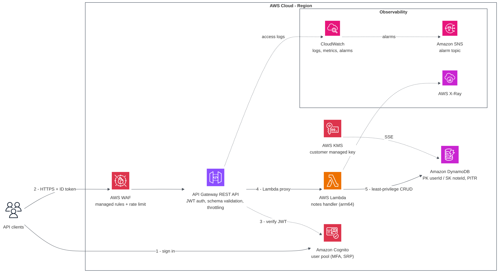

# 01 - Secure Serverless REST API

A production-style, multi-user CRUD API for "notes". Requests are authenticated by **Amazon Cognito**, filtered by **AWS WAF**, validated by **Amazon API Gateway**, handled by **AWS Lambda** and stored in **Amazon DynamoDB**. Each user can only ever see their own data.

**Services:** API Gateway (REST), Lambda, DynamoDB, Cognito, AWS WAF, AWS KMS, CloudWatch, X-Ray, SNS, IAM

## Architecture



<sub>Diagram source: [`architecture.mmd`](architecture.mmd) (Mermaid + official AWS Architecture Icons)</sub>

### Request flow

1. A user signs in to the Cognito user pool (SRP; MFA optional) and receives an ID token.
2. The client calls the API over HTTPS with `Authorization: <ID token>`. AWS WAF checks the request first: AWS managed rules (Common, Known Bad Inputs, IP reputation) and a per-IP rate limit.
3. API Gateway verifies the JWT with the Cognito authorizer, validates the JSON body against a schema model, and enforces stage throttling.
4. The Lambda proxy integration runs the handler (Python 3.13, Graviton/arm64).
5. The handler reads and writes DynamoDB items keyed by `userId` (taken from the verified token's `sub` claim, never from client input) and `noteId`.

## Endpoints

| Method | Path | Description |
|---|---|---|
| `GET` | `/notes` | List the caller's notes (up to 100) |
| `POST` | `/notes` | Create a note: `{"title": "...", "content": "..."}` |
| `GET` | `/notes/{noteId}` | Get one note |
| `PUT` | `/notes/{noteId}` | Replace title/content |
| `DELETE` | `/notes/{noteId}` | Delete a note |

## Security and best practices

| Area | Implementation |
|---|---|
| Identity | Cognito user pool: admin-only sign-up, 12+ character password policy, optional TOTP MFA, user-existence errors suppressed, token revocation, 60-minute tokens |
| Authorization | Cognito authorizer on every method. Tenant isolation: the partition key comes from the verified `sub` claim |
| Least privilege | The Lambda role can only `Get/Put/Update/Delete/Query` this table and write to its own log group. KMS use is restricted with `kms:ViaService` to DynamoDB |
| Encryption | DynamoDB and SNS encrypted with a customer managed KMS key (rotation on). TLS in transit |
| Edge protection | Regional AWS WAF web ACL with 3 managed rule groups and a rate-based rule |
| Input validation | API Gateway request validator with a JSON schema (`additionalProperties: false`, length limits), plus conditional writes in DynamoDB |
| Resilience | DynamoDB on-demand with point-in-time recovery. Retain policies on data and key |
| Observability | JSON structured logs, API access logs (with WAF status and X-Ray trace ID), X-Ray active tracing, alarms on Lambda errors/throttles and API 5XX / p99 latency to an SNS topic |

## Deploy

Prerequisites: AWS CLI v2 with credentials that can create IAM roles.

```bash
aws cloudformation deploy \
  --stack-name notes-api \
  --template-file template.yaml \
  --capabilities CAPABILITY_IAM \
  --parameter-overrides AlarmEmail=you@example.com
```

| Parameter | Default | Notes |
|---|---|---|
| `ProjectName` | `notes-api` | Prefix for named resources. Must be unique per account and Region |
| `StageName` | `prod` | API stage |
| `AlarmEmail` | *(blank)* | Confirm the SNS subscription e-mail if set |
| `LogRetentionInDays` | `30` | |
| `EnableTableDeletionProtection` | `false` | Set `true` for production |

> **Account-level setting:** this stack sets the Region-wide API Gateway CloudWatch Logs role (`AWS::ApiGateway::Account`). If your account already has one, it is replaced by an equivalent role. The role is retained on stack deletion so that other APIs keep logging.

## Test

```bash
STACK=notes-api
out() { aws cloudformation describe-stacks --stack-name $STACK --query "Stacks[0].Outputs[?OutputKey=='$1'].OutputValue" --output text; }
POOL=$(out UserPoolId); CLIENT=$(out UserPoolClientId); API=$(out ApiUrl)

# Create a user (admin-only sign-up) and set a permanent password
aws cognito-idp admin-create-user --user-pool-id $POOL --username alice@example.com --message-action SUPPRESS
aws cognito-idp admin-set-user-password --user-pool-id $POOL --username alice@example.com --password 'Str0ng!Passw0rd' --permanent

TOKEN=$(aws cognito-idp admin-initiate-auth --user-pool-id $POOL --client-id $CLIENT \
  --auth-flow ADMIN_USER_PASSWORD_AUTH --auth-parameters USERNAME=alice@example.com,PASSWORD='Str0ng!Passw0rd' \
  --query AuthenticationResult.IdToken --output text)

curl -s -X POST "$API/notes" -H "Authorization: $TOKEN" -H 'Content-Type: application/json' -d '{"title":"hello","content":"first note"}'
curl -s "$API/notes" -H "Authorization: $TOKEN"
curl -s -o /dev/null -w '%{http_code}\n' "$API/notes"   # 401 without a token
curl -s -X POST "$API/notes" -H "Authorization: $TOKEN" -H 'Content-Type: application/json' -d '{"bad":1}'  # 400 schema validation
```

## Cost

Mostly pay-per-request (API Gateway, Lambda, DynamoDB on-demand). The fixed monthly costs are the WAF web ACL and its 4 rules (about $9 plus request charges) and the KMS key ($1). Cognito's free tier covers small user counts.

## Clean up

```bash
aws cloudformation delete-stack --stack-name notes-api
```

These resources are **retained** on purpose: the DynamoDB table, the KMS key and the API Gateway logging role. Delete them manually once you are sure (KMS keys have a 7-30 day deletion window).

## Design notes and extensions

- **REST API rather than HTTP API** was chosen for WAF integration, request validation and usage plans. Solution 05 shows the HTTP API alternative.
- `AWS::ApiGateway::Deployment` does not redeploy automatically when methods change. In a pipeline, change the deployment's logical ID or description on every API change (or use SAM, which does this for you).
- For browser clients, add CORS (OPTIONS methods plus gateway responses) and use the Cognito Hosted UI / OAuth code flow.
- For larger codebases, package the function with SAM/CDK and add Powertools for AWS Lambda (idempotency, metrics, tracing).
