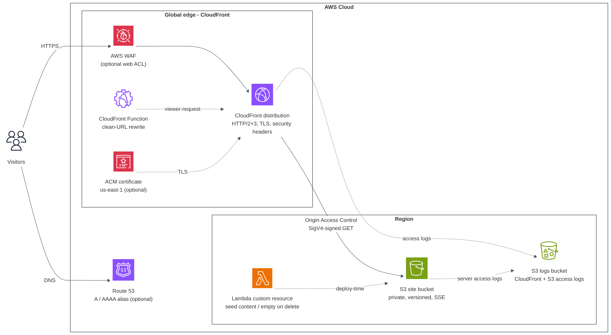

# 02 - Secure Static Website on S3 + CloudFront

Hosts a static website from a **private** Amazon S3 bucket, delivered globally by **Amazon CloudFront**. The bucket has no public access at all. CloudFront reads it with **Origin Access Control (OAC)** SigV4-signed requests, and the bucket policy only trusts this one distribution.

**Services:** S3, CloudFront (OAC, CloudFront Functions, response headers policy), Lambda (custom resource), IAM. Optional: Route 53, ACM, AWS WAF

## Architecture



<sub>Diagram source: [`architecture.mmd`](architecture.mmd)</sub>

### What gets deployed

- **Site bucket:** Block Public Access on all four settings, ACLs disabled (`BucketOwnerEnforced`), SSE-S3 encryption, versioning, lifecycle cleanup of old versions, server access logging, TLS-only bucket policy.
- **CloudFront distribution:** HTTP/2 and HTTP/3, IPv6, HTTPS redirect, managed `CachingOptimized` cache policy, compression, custom 404 page.
- **Origin Access Control:** the bucket policy grants `s3:GetObject`/`s3:ListBucket` only to `cloudfront.amazonaws.com`, with a condition on this distribution's ARN (`AWS:SourceArn`). `ListBucket` makes S3 return a real 404 instead of a 403 for missing objects.
- **Response headers policy:** HSTS (2 years, preload), CSP, `X-Content-Type-Options`, `X-Frame-Options: DENY`, `Referrer-Policy`, `Permissions-Policy`.
- **CloudFront Function** (viewer request, `cloudfront-js-2.0`): rewrites `/docs` and `/docs/` to `/docs/index.html`. This avoids the S3 website endpoint, which would require a public bucket.
- **Logs bucket:** CloudFront standard logs and S3 server access logs, with 90-day expiry.
- **Custom resource (Lambda):** seeds sample pages on create, and on delete empties all object versions so the stack deletes cleanly.
- **Optional:** custom domain (ACM certificate in **us-east-1** + Route 53 A/AAAA alias records) and an AWS WAF web ACL (CLOUDFRONT scope).

## Deploy

```bash
# Default *.cloudfront.net domain
aws cloudformation deploy \
  --stack-name static-site \
  --template-file template.yaml \
  --capabilities CAPABILITY_IAM

# With a custom domain (certificate must be in us-east-1)
aws cloudformation deploy \
  --stack-name static-site \
  --template-file template.yaml \
  --capabilities CAPABILITY_IAM \
  --parameter-overrides \
      DomainName=www.example.com \
      AcmCertificateArn=arn:aws:acm:us-east-1:111122223333:certificate/abcd... \
      HostedZoneId=Z0123456789ABC
```

| Parameter | Default | Notes |
|---|---|---|
| `DomainName` | *(blank)* | Used only if `AcmCertificateArn` is also set |
| `AcmCertificateArn` | *(blank)* | Must be an ACM certificate in **us-east-1** |
| `HostedZoneId` | *(blank)* | Creates alias records when set together with the domain |
| `WebAclArn` | *(blank)* | WAFv2 web ACL with `CLOUDFRONT` scope |
| `PriceClass` | `PriceClass_100` | North America + Europe edge locations |

> Keep the stack name to 45 characters or fewer: it prefixes the CloudFront Function and OAC names, which are limited to 64 characters.
> Deploy in a Region where S3 can receive CloudFront standard logs; most Regions launched after December 2022 cannot.

## Publish your own content

```bash
BUCKET=$(aws cloudformation describe-stacks --stack-name static-site --query "Stacks[0].Outputs[?OutputKey=='SiteBucketName'].OutputValue" --output text)
DIST=$(aws cloudformation describe-stacks --stack-name static-site --query "Stacks[0].Outputs[?OutputKey=='DistributionId'].OutputValue" --output text)
aws s3 sync ./site "s3://$BUCKET" --delete
aws cloudfront create-invalidation --distribution-id "$DIST" --paths '/*'
```

## Test

```bash
URL=$(aws cloudformation describe-stacks --stack-name static-site --query "Stacks[0].Outputs[?OutputKey=='WebsiteUrl'].OutputValue" --output text)
curl -sI "$URL" | grep -iE 'strict-transport|content-security|x-frame'   # security headers
curl -s "$URL/docs" | grep '<h1>'                                          # clean-URL rewrite
curl -s -o /dev/null -w '%{http_code}\n' "$URL/missing"                   # 404
curl -s -o /dev/null -w '%{http_code}\n' "https://$BUCKET.s3.amazonaws.com/index.html"  # 403: bucket is private
```

## Cost

Pennies for low traffic: S3 storage, CloudFront requests and transfer (the always-free tier covers 1 TB/month), CloudFront Functions invocations. WAF adds about $5/month plus rules if you attach one.

## Clean up

```bash
aws cloudformation delete-stack --stack-name static-site
```

The custom resource empties the site bucket automatically. The **logs bucket is retained**; empty and delete it manually.

## Design notes

- **OAC rather than OAI:** OAC is the current recommendation. It supports SSE-KMS, all Regions and dynamic requests.
- **REST endpoint plus a CloudFront Function, rather than the S3 website endpoint:** this keeps the bucket fully private and still supports `index.html` for subdirectories.
- For an SPA, replace the URL-rewrite logic with "rewrite any extension-less path to `/index.html`".
