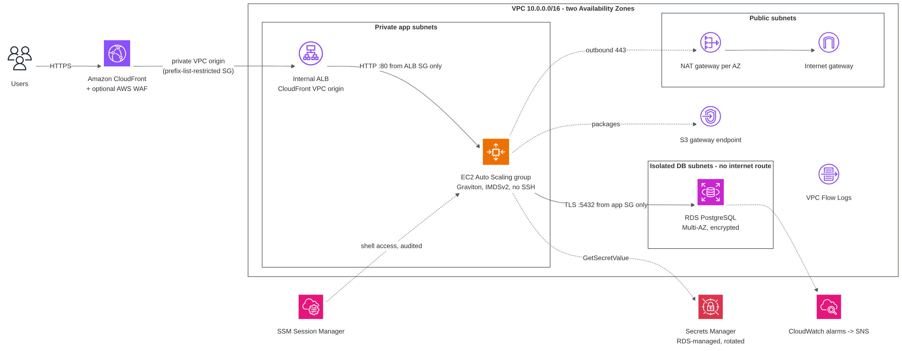

# 03 - Highly Available Three-Tier Web Application

A classic web / app / database architecture built the modern way. **Amazon CloudFront** is the only public entry point. It reaches an **internal** Application Load Balancer in private subnets through a **CloudFront VPC origin**. An **EC2 Auto Scaling group** of Graviton instances serves the app, and an encrypted **Multi-AZ Amazon RDS for PostgreSQL** database sits in isolated subnets with no internet route.

**Services:** CloudFront (VPC origins), VPC, Elastic Load Balancing (ALB), EC2 + Auto Scaling, RDS PostgreSQL, Secrets Manager, Systems Manager, CloudWatch, SNS, KMS, Lambda (custom resource), IAM

## Architecture



<sub>Diagram source: [`architecture.mmd`](architecture.mmd)</sub>

### Network layout (two AZs)

| Tier | Subnets | Route to internet | Contents |
|---|---|---|---|
| Public | 2 x /24 | Internet gateway | NAT gateways only. Nothing else has a public IP |
| App (private) | 2 x /24 | NAT gateway (one per AZ by default) + S3 gateway endpoint | Internal ALB, EC2 instances, CloudFront VPC origin ENIs |
| Data (isolated) | 2 x /24 | **None** | RDS primary + synchronous standby |

VPC Flow Logs (all traffic) go to CloudWatch Logs.

### Traffic path and security-group chain

```
Internet --HTTPS--> CloudFront --(VPC origin, private)--> ALB SG  [80 from CloudFront origin-facing prefix list only]
                                                          --> App SG  [80 from ALB SG only]
                                                          --> DB SG   [5432 from App SG only, no egress]
```

- **The ALB is internal**, with no public IP or DNS. CloudFront reaches it through a service-managed ENI in the VPC (VPC origins).
- The ALB security group allows only the **`com.amazonaws.global.cloudfront.origin-facing`** managed prefix list. Its ID differs by Region, so a small Lambda-backed custom resource looks it up at deploy time.
- App instances allow outbound only 443 (AWS APIs, SSM, packages) and 5432 to the VPC.

## Security and best practices

| Area | Implementation |
|---|---|
| No SSH, no bastion | No key pairs, port 22 is never opened. Shell access is through **SSM Session Manager** (IAM-authorised, audited) |
| Instance hardening | **IMDSv2 required** (hop limit 1), encrypted gp3 root volumes, latest Amazon Linux 2023 AMI resolved from the public SSM parameter |
| Credentials | `ManageMasterUserPassword: true`. RDS generates the password, stores it in **Secrets Manager** and rotates it. The instance role can read only that one secret |
| Database | Multi-AZ, storage encrypted, not publicly accessible, isolated subnets, TLS enforced (PostgreSQL 15+ default `rds.force_ssl=1`; the demo app verifies the RDS CA bundle), IAM DB auth enabled, 7-day backups, enhanced monitoring, logs exported to CloudWatch, snapshot on delete |
| Edge | HTTPS redirect, managed `SecurityHeadersPolicy`, caching disabled for dynamic content, optional AWS WAF |
| Availability | Two AZs end to end, NAT per AZ, ELB health checks, CPU target-tracking scaling (50%), rolling updates that wait for `cfn-signal` |
| Observability | Alarms for unhealthy hosts, target 5XX, DB CPU and free storage, sent to a KMS-encrypted SNS topic |

## Deploy

```bash
aws cloudformation deploy \
  --stack-name three-tier \
  --template-file template.yaml \
  --capabilities CAPABILITY_IAM \
  --parameter-overrides AlarmEmail=you@example.com
```

Expect **25-40 minutes**: Multi-AZ RDS, then the instances signalling, then CloudFront (VPC origins can take up to 15 minutes to deploy).

| Parameter | Default | Notes |
|---|---|---|
| `VpcCidr` | `10.0.0.0/16` | Split into six /24s |
| `HighlyAvailableNat` | `true` | `false` = one NAT gateway (cheaper, single-AZ egress) |
| `InstanceType` | `t4g.small` | Graviton only (the AMI is arm64) |
| `MinSize` / `MaxSize` / `DesiredCapacity` | 2 / 6 / 2 | |
| `DbInstanceClass` | `db.t4g.small` | |
| `DbAllocatedStorage` | `20` | Storage autoscaling up to 100 GiB |
| `DbDeletionProtection` | `false` | `true` for production |
| `WebAclArn` | *(blank)* | CLOUDFRONT-scope web ACL ARN |

> Deploy in a Region that supports CloudFront VPC origins (most commercial Regions; see the [supported Regions list](https://docs.aws.amazon.com/AmazonCloudFront/latest/DeveloperGuide/private-content-vpc-origins.html)).

## Test

```bash
URL=$(aws cloudformation describe-stacks --stack-name three-tier --query "Stacks[0].Outputs[?OutputKey=='ApplicationUrl'].OutputValue" --output text)
curl -s "$URL" | grep 'Served by'     # refresh: instance and AZ change as the ALB balances
curl -s "$URL/api/db"                 # {"instance": "...", "visits": N, "postgres": "...", "tls": true}

# Prove the ALB is not reachable from the internet (internal DNS name resolves to private IPs)
dig +short $(aws cloudformation describe-stacks --stack-name three-tier --query "Stacks[0].Outputs[?OutputKey=='InternalAlbDnsName'].OutputValue" --output text)

# Shell into an instance without SSH
ASG=$(aws cloudformation describe-stacks --stack-name three-tier --query "Stacks[0].Outputs[?OutputKey=='AutoScalingGroupName'].OutputValue" --output text)
IID=$(aws autoscaling describe-auto-scaling-groups --auto-scaling-group-names $ASG --query 'AutoScalingGroups[0].Instances[0].InstanceId' --output text)
aws ssm start-session --target $IID
```

## How the instances bootstrap

User data installs nginx, writes a landing page and a `/health` endpoint, then sends **`cfn-signal`**. The ASG `CreationPolicy` waits for one signal per instance, so the stack only succeeds once instances are actually serving. A small Python app tier (`/api/*`, proxied by nginx) is installed afterwards on a best-effort basis. It reads the DB secret from Secrets Manager and connects over verified TLS. The log is at `/var/log/user-data.log`.

## Cost (indicative, us-east-1, on-demand)

Roughly **$150-180/month** as deployed: 2 NAT gateways (~$65 plus data), Multi-AZ `db.t4g.small` (~$50), 2 x `t4g.small` (~$25), ALB (~$18), plus CloudFront, logs and KMS. Set `HighlyAvailableNat=false` and use smaller sizes for a lab.

## Clean up

```bash
aws cloudformation delete-stack --stack-name three-tier
```

A final DB snapshot is kept (`DeletionPolicy: Snapshot`). Delete it manually when no longer needed. If VPC deletion stalls, check for the CloudFront-managed `CloudFront-VPCOrigins-Service-SG` security group. CloudFront removes it after the VPC origin is deleted, which can take several minutes. Then retry the delete.

## Production hardening ideas

- HTTPS on the ALB (ACM certificate) with `OriginProtocolPolicy: https-only` on the VPC origin, for end-to-end encryption.
- A custom domain and ACM certificate on CloudFront. ALB and CloudFront access logs. WAF with managed rules.
- An application DB user (rather than the master user) with least privilege, and IAM DB authentication. Cache the secret in-process.
- Interface VPC endpoints for SSM/Secrets Manager/CloudWatch, to cut NAT dependency and cost.
- Bake AMIs with EC2 Image Builder instead of installing packages at boot.
