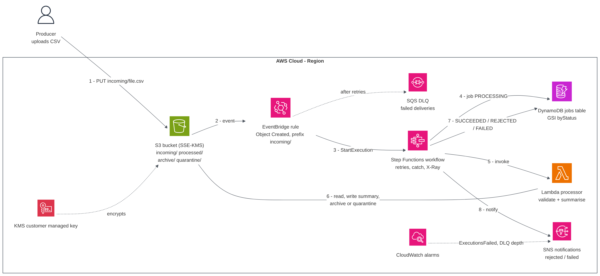

# 04 - Event-Driven File Processing Pipeline

A serverless pipeline that validates and transforms CSV files as soon as they land in Amazon S3. **S3 to Amazon EventBridge** notifications start an **AWS Step Functions** workflow. The workflow records job state in **Amazon DynamoDB** through direct service integrations (no glue code), runs validation in **AWS Lambda**, files each object as archived or quarantined, and notifies people through **Amazon SNS**.

**Services:** S3, EventBridge, Step Functions, Lambda, DynamoDB, SNS, SQS, KMS, CloudWatch, X-Ray, IAM

## Architecture



<sub>Diagram source: [`architecture.mmd`](architecture.mmd)</sub>

### Workflow

```
RecordJobStarted (DynamoDB PutItem, status=PROCESSING)
      |
ProcessFile (Lambda) -- retries with exponential backoff + jitter --> Catch --> RecordJobFailed --> NotifyFailed (SNS) --> Fail
      |
IsFileValid?
  |-- yes --> RecordJobSucceeded (DynamoDB UpdateItem: rowCount, outputKey, archivedKey)
  |-- no  --> RecordJobRejected  (DynamoDB UpdateItem: reason, quarantineKey) --> NotifyRejected (SNS)
```

### Bucket layout

| Prefix | Meaning | Lifecycle |
|---|---|---|
| `incoming/` | Drop files here. Only this prefix triggers the workflow | Objects are moved out by the processor |
| `processed/` | `<file>.summary.json` with row count and per-currency totals | |
| `archive/` | Valid source files | Standard-IA after 30 days, Glacier Instant Retrieval after 90 |
| `quarantine/` | Rejected files (bad schema, bad rows, not UTF-8, too large) | Expire after 90 days |

The processor checks that the header contains `RequiredColumns` (default `id,date,amount,currency`), that every `amount` is a decimal, that `currency` is a 3-letter code, and that the file is at most 50 MB.

## Security and best practices

| Area | Implementation |
|---|---|
| Least privilege | The Lambda role can only read/delete `incoming/*` and write `processed/`, `archive/` and `quarantine/`. The Step Functions role can only invoke this function, write this table and publish to this topic. The EventBridge role can only start this state machine |
| Encryption | A customer managed KMS key (rotation on) for S3 (with S3 Bucket Keys to cut KMS calls), DynamoDB and SNS. KMS permissions are scoped with `kms:ViaService`. The DLQ uses SSE-SQS |
| S3 | Block Public Access, ACLs disabled, versioning, TLS-only bucket policy, lifecycle tiering |
| Confused-deputy protection | Service trust policies use `aws:SourceAccount`. The DLQ policy allows only this rule (`aws:SourceArn`) |
| Reliability | EventBridge retry policy (8 attempts / 1 hour) then an **SQS dead-letter queue**. Step Functions retries with full jitter. Every failure path is recorded and notified. Standard workflows give exactly-once execution history for audit |
| Observability | State machine logs (`/aws/vendedlogs/...`), X-Ray tracing across Step Functions and Lambda, JSON Lambda logs, alarms on `ExecutionsFailed` and DLQ depth |
| Queryable state | A DynamoDB `byStatus` GSI lets you list all `FAILED` or `REJECTED` jobs by time |

## Deploy

```bash
aws cloudformation deploy \
  --stack-name file-pipeline \
  --template-file template.yaml \
  --capabilities CAPABILITY_IAM \
  --parameter-overrides NotificationEmail=you@example.com
```

| Parameter | Default | Notes |
|---|---|---|
| `ProjectName` | `file-pipeline` | Prefix for named resources |
| `NotificationEmail` | *(blank)* | Receives rejection/failure messages and alarms |
| `RequiredColumns` | `id,date,amount,currency` | Header columns every file must contain |

## Test

```bash
BUCKET=$(aws cloudformation describe-stacks --stack-name file-pipeline --query "Stacks[0].Outputs[?OutputKey=='DataBucketName'].OutputValue" --output text)
TABLE=$(aws cloudformation describe-stacks --stack-name file-pipeline --query "Stacks[0].Outputs[?OutputKey=='JobsTableName'].OutputValue" --output text)

printf 'id,date,amount,currency\n1,2026-11-01,120.50,GBP\n2,2026-11-02,99.99,USD\n' > good.csv
printf 'id,date,amount,currency\n1,2026-11-01,abc,GBP\n' > bad.csv
aws s3 cp good.csv "s3://$BUCKET/incoming/good.csv"
aws s3 cp bad.csv  "s3://$BUCKET/incoming/bad.csv"

sleep 15
aws s3 ls "s3://$BUCKET" --recursive          # processed/good.csv.summary.json, archive/good.csv, quarantine/bad.csv
aws dynamodb query --table-name $TABLE --index-name byStatus \
  --key-condition-expression '#s = :s' --expression-attribute-names '{"#s":"status"}' \
  --expression-attribute-values '{":s":{"S":"REJECTED"}}'
```

Open the state machine in the Step Functions console to see each execution's graph.

## Cost

Fully pay-per-use: Step Functions Standard (~$0.025 per 1,000 state transitions; about 4 per file), Lambda, DynamoDB on-demand, EventBridge (AWS service events are free), S3, plus $1/month for the KMS key. Very high volumes are a good fit for Express workflows.

## Clean up

```bash
aws cloudformation delete-stack --stack-name file-pipeline
```

The **bucket, table and KMS key are retained** to protect data. Empty and delete them manually.

## Design notes

- **EventBridge rather than classic S3 notifications:** content-based filtering (prefix, size, suffix), multiple targets, retries/DLQ, archive and replay, and no bucket-to-function coupling.
- **Step Functions direct integrations** (DynamoDB, SNS) remove Lambda glue code and its failure modes. Lambda is used only for real compute.
- S3 events are delivered at least once. The job ID is the execution name, and the processor moves objects out of `incoming/`, so duplicate events end up as a `FAILED` job (file not found) rather than double processing. Add idempotency on `sequencer` if strict once-only behaviour matters.
- The processor resolves URL-encoded object keys defensively, so keys with spaces or special characters work.
