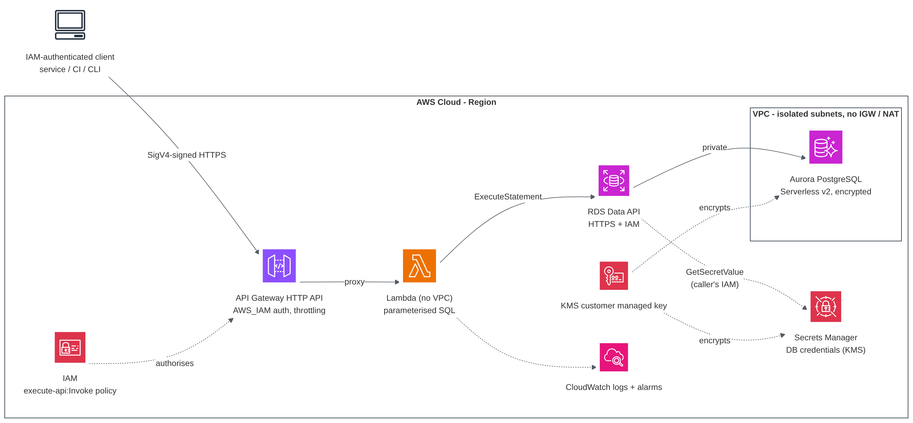

# 05 - Serverless Relational API (Aurora Serverless v2 + RDS Data API)

A relational, SQL-backed API that is still fully serverless. An **API Gateway HTTP API** with **IAM (SigV4) authorization** invokes **AWS Lambda**, which queries **Amazon Aurora PostgreSQL Serverless v2** through the **RDS Data API**. The Data API is an HTTPS endpoint authorised by IAM, so the function needs **no VPC attachment, no NAT, no connection pool and no database driver**. The database itself sits in isolated subnets with no inbound security-group rules.

**Services:** API Gateway (HTTP API), Lambda, Aurora PostgreSQL Serverless v2, RDS Data API, Secrets Manager, KMS, VPC, CloudWatch, X-Ray, IAM

## Architecture



<sub>Diagram source: [`architecture.mmd`](architecture.mmd)</sub>

## Endpoints

All routes use `AWS_IAM` authorization, so callers must sign requests with SigV4 and hold `execute-api:Invoke` (the stack outputs a ready-made managed policy).

| Method | Path | Description |
|---|---|---|
| `GET` | `/products` | List the newest 100 products |
| `POST` | `/products` | Create: `{"name": "Widget", "price": 9.99}` |
| `GET` | `/products/{id}` | Get one product (UUID) |
| `DELETE` | `/products/{id}` | Delete a product |

The table (`products`: UUID primary key, `numeric(12,2)` price with a `CHECK` constraint, `timestamptz`) is created idempotently on the function's first cold start.

## Why this design

| Classic Lambda + RDS | This solution |
|---|---|
| Lambda in a VPC, ENIs, NAT or endpoints for AWS APIs | Lambda outside the VPC. The Data API is called over HTTPS with IAM |
| Connection storms at scale, so RDS Proxy is needed | Data API manages connections |
| Bundled drivers (psycopg/pg8000) and a CA bundle | Only `boto3`, which is in the runtime |
| Always-on instance | Serverless v2 scales in 0.5 ACU steps and optionally to **0 ACU** (auto-pause) |

## Security and best practices

| Area | Implementation |
|---|---|
| API authN/Z | `AWS_IAM` on every route. Access is granted by attaching the `ApiClientPolicy` managed policy, scoped to this API's routes |
| Least privilege | The Lambda role can call `rds-data:*Statement`/transaction actions **only on this cluster ARN**, read **only this secret**, and decrypt with the CMK only via Secrets Manager (`kms:ViaService`) |
| SQL injection | Every statement uses Data API **named parameters** with type hints (`UUID`, `DECIMAL`). There is no string concatenation |
| Network isolation | Cluster in isolated subnets of a dedicated VPC with no IGW or NAT. The security group has **no inbound rules** and no egress |
| Encryption | Aurora storage and the Secrets Manager secret are encrypted with a customer managed KMS key (rotation on). TLS for the Data API and API Gateway |
| Credentials | Generated by Secrets Manager (32 characters), never in the template, resolved with dynamic references. `SecretTargetAttachment` links host/port metadata |
| Resilience | 7-day backups, snapshot on delete, optional reader in a second AZ (`CreateReaderInstance=true`), retry/backoff for `DatabaseResumingException` when auto-pause is on |
| Observability | HTTP API access logs with the caller's IAM ARN, X-Ray, JSON logs, enhanced monitoring, PostgreSQL logs exported, alarms on Lambda errors, API 5xx and ACU utilisation |

## Deploy

```bash
aws cloudformation deploy \
  --stack-name catalog-api \
  --template-file template.yaml \
  --capabilities CAPABILITY_IAM
```

| Parameter | Default | Notes |
|---|---|---|
| `ProjectName` | `catalog` | Prefix for named resources |
| `MinCapacity` | `0.5` | `0` enables auto-pause after 15 minutes idle. The first request after a pause takes about 15 s and is retried by the function |
| `MaxCapacity` | `4` | ACUs |
| `CreateReaderInstance` | `false` | `true` for Multi-AZ failover |
| `DbDeletionProtection` | `false` | `true` for production |
| `VpcCidr` | `10.20.0.0/24` | Two /26 isolated subnets |

The template uses the Region's **default** Aurora PostgreSQL engine version. The Data API requires Aurora PostgreSQL 13.11+, 14.8+, 15.3+, 16.1+ or 17.4+, and every current default meets that.

## Test

`awscurl` signs requests with your current AWS credentials:

```bash
pip install awscurl
API=$(aws cloudformation describe-stacks --stack-name catalog-api --query "Stacks[0].Outputs[?OutputKey=='ApiEndpoint'].OutputValue" --output text)
REGION=$(aws configure get region)

awscurl --service execute-api --region $REGION -X POST "$API/products" \
  -H 'Content-Type: application/json' -d '{"name":"Widget","price":9.99}'
awscurl --service execute-api --region $REGION "$API/products"
curl -s -o /dev/null -w '%{http_code}\n' "$API/products"   # 403: unsigned request rejected
```

To grant another role access:

```bash
POLICY=$(aws cloudformation describe-stacks --stack-name catalog-api --query "Stacks[0].Outputs[?OutputKey=='ApiClientPolicyArn'].OutputValue" --output text)
aws iam attach-role-policy --role-name <consumer-role> --policy-arn $POLICY
```

## Cost

At `MinCapacity=0.5`, Aurora Serverless v2 costs about $43/month in us-east-1 for the writer. Use `MinCapacity=0` to pay only for storage while idle. The Data API, HTTP API and Lambda are pay-per-request. Add $1/month for the KMS key and $0.40/month for the secret.

## Clean up

```bash
aws cloudformation delete-stack --stack-name catalog-api
```

A final cluster snapshot is taken, and the KMS key is retained. Delete both manually when done (the snapshot needs the key to restore).

## Production hardening ideas

- Turn on Secrets Manager rotation (`AWS::SecretsManager::RotationSchedule` with a hosted rotation Lambda plus a VPC endpoint), and use a separate least-privilege application DB role instead of the admin user.
- Put the API behind CloudFront + WAF, or switch to a JWT authorizer for end-user (rather than machine-to-machine) access.
- Add pagination (keyset on `created_at, id`) and request validation. Use Data API transactions for multi-statement writes.
