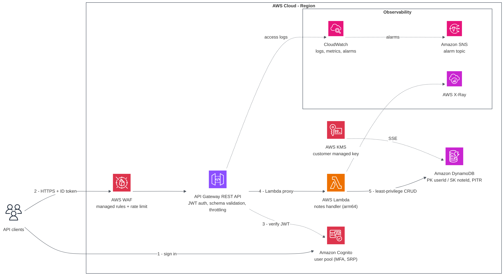
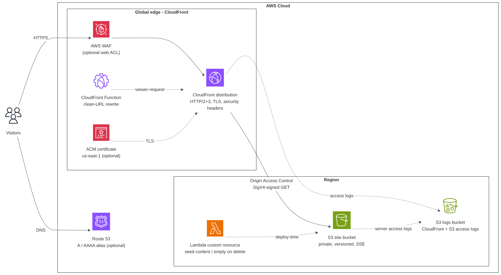
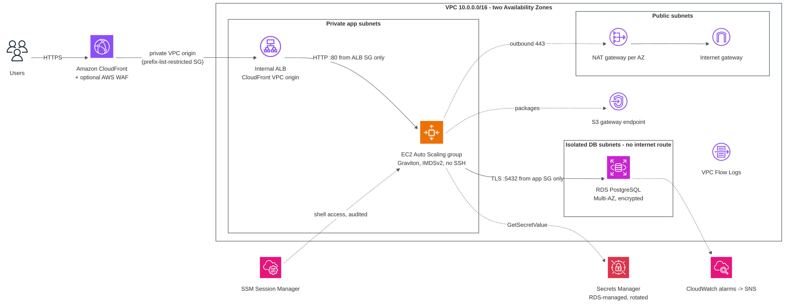
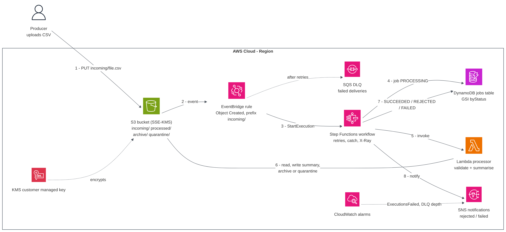
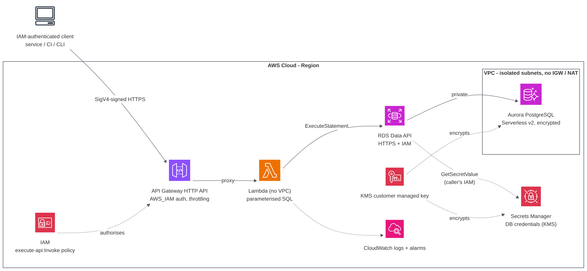

# AWS Solutions - CloudFormation Reference Architectures

Five production-style AWS architectures, each fully defined as **Infrastructure as Code with AWS CloudFormation**. Every solution deploys from a single template with no pre-built artifacts and no manual steps. Each one has its own README and an architecture diagram drawn with the official AWS Architecture Icons.

The set covers the core building blocks of AWS (**Lambda, API Gateway, DynamoDB, EC2, S3, RDS/Aurora and CloudFront**), applied with the security, reliability and operational practices of the AWS Well-Architected Framework.

## Solutions

| # | Solution | Pattern | Key services | Deploy time |
|---|---|---|---|---|
| 01 | [**Secure Serverless REST API**](01-serverless-rest-api/) | Multi-user CRUD API with per-user data isolation | API Gateway (REST), Lambda, DynamoDB, Cognito, WAF, KMS, X-Ray | ~3 min |
| 02 | [**Secure Static Website**](02-static-website-cloudfront/) | Private S3 origin behind a global CDN | S3, CloudFront (OAC, Functions, security headers), Route 53, ACM | ~5 min |
| 03 | [**Highly Available Three-Tier Web App**](03-three-tier-web-app/) | CloudFront to internal ALB (VPC origin) to EC2 Auto Scaling to Multi-AZ RDS | VPC, CloudFront, ALB, EC2, Auto Scaling, RDS PostgreSQL, Secrets Manager, SSM | ~35 min |
| 04 | [**Event-Driven File Processing**](04-event-driven-file-processing/) | S3 upload to orchestrated validation workflow | S3, EventBridge, Step Functions, Lambda, DynamoDB, SNS, SQS | ~3 min |
| 05 | [**Serverless Relational API**](05-serverless-aurora-data-api/) | SQL backend without VPC Lambdas or connection pools | API Gateway (HTTP API, IAM auth), Lambda, Aurora Serverless v2, RDS Data API | ~15 min |

### Architecture at a glance

| | |
|---|---|
| [](01-serverless-rest-api/) **01 Serverless REST API** | [](02-static-website-cloudfront/) **02 Static website** |
| [](03-three-tier-web-app/) **03 Three-tier web app** | [](04-event-driven-file-processing/) **04 Event-driven processing** |
| [](05-serverless-aurora-data-api/) **05 Aurora Serverless + Data API** | |

### Service coverage

| Service | 01 | 02 | 03 | 04 | 05 |
|---|:-:|:-:|:-:|:-:|:-:|
| AWS Lambda | ✓ | ✓ | ✓ | ✓ | ✓ |
| Amazon API Gateway | REST | | | | HTTP |
| Amazon DynamoDB | ✓ | | | ✓ | |
| Amazon EC2 / Auto Scaling | | | ✓ | | |
| Amazon S3 | | ✓ | ✓ | ✓ | |
| Amazon RDS / Aurora | | | RDS | | Aurora |
| Amazon CloudFront | | ✓ | ✓ | | |
| Amazon VPC | | | ✓ | | ✓ |
| AWS KMS (customer managed key) | ✓ | | ✓ | ✓ | ✓ |
| AWS Secrets Manager | | | ✓ | | ✓ |
| AWS WAF | ✓ | optional | optional | | |
| Amazon Cognito | ✓ | | | | |
| Step Functions / EventBridge | | | | ✓ | |

## Security baseline applied everywhere

- **IAM roles only, least privilege:** every compute resource (Lambda, EC2, Step Functions, EventBridge, API Gateway, RDS monitoring) runs under its own role. Policies are scoped to specific resource ARNs, with condition keys (`kms:ViaService`, `aws:SourceArn`, `aws:SourceAccount`) against the confused-deputy problem. There are no long-lived access keys, no SSH keys and no hard-coded secrets.
- **Encryption everywhere:** customer managed KMS keys with automatic rotation for sensitive data stores; TLS-only bucket and queue policies; HTTPS-only viewers.
- **No public data stores:** S3 Block Public Access and `BucketOwnerEnforced` throughout; databases in isolated subnets that are never publicly accessible.
- **Generated, managed credentials:** databases use Secrets Manager (RDS-managed rotation in 03), resolved through dynamic references, never in parameters or outputs.
- **Defence in depth at the edge:** AWS WAF managed rules and rate limiting, CloudFront security response headers, origin access locked to CloudFront (OAC / VPC origins / managed prefix lists).
- **Operability:** structured JSON logs with retention, X-Ray tracing, CloudWatch alarms to encrypted SNS topics, and data retained or snapshotted on delete.

### Validation

Every template is checked in CI ([`.github/workflows/validate.yml`](.github/workflows/validate.yml)):

- **[cfn-lint](https://github.com/aws-cloudformation/cfn-lint):** resource schemas, intrinsic functions, attribute names: 0 errors, 0 warnings.
- **[Checkov](https://www.checkov.io/):** 219 security checks passed, 0 failed. The 39 suppressed checks are deliberate design decisions, each recorded in the resource's `Metadata.checkov.skip` with a written justification (for example, Lambdas that only call AWS APIs are intentionally *not* VPC-attached).
- All inline Lambda code was unit-tested against mocked AWS APIs (moto and stubbed clients), and the EC2 user-data script was syntax-checked.
- Design choices were checked against the AWS documentation (CloudFront VPC origins, RDS Data API authorisation, DynamoDB KMS requirements, API Gateway logging). The templates are statically validated; run them in a sandbox account before production use.

## Getting started

Prerequisites: an AWS account, AWS CLI v2 configured with permissions to create IAM roles, and (for 02/03) the ability to create CloudFront distributions.

```bash
git clone https://github.com/SwatiQFin/AWS_Solutions.git
cd AWS_Solutions/01-serverless-rest-api
aws cloudformation deploy --stack-name notes-api --template-file template.yaml --capabilities CAPABILITY_IAM
```

Each solution README covers parameters, test commands, indicative cost, clean-up and production hardening ideas.

> **Cost warning:** solutions 03 (NAT gateways, Multi-AZ RDS, ALB) and 05 (Aurora at 0.5 ACU minimum) incur hourly charges while deployed. Delete stacks you are not using. Data stores are retained or snapshotted on deletion by design; see each README's clean-up section.

## Repository layout

```
.
├── 01-serverless-rest-api/            template.yaml, README.md, architecture.mmd, architecture.png
├── 02-static-website-cloudfront/
├── 03-three-tier-web-app/
├── 04-event-driven-file-processing/
├── 05-serverless-aurora-data-api/
├── tools/diagrams/                    renders *.mmd -> *.png with the official AWS icon set
└── .github/workflows/validate.yml     cfn-lint + Checkov on every push / PR
```

## Diagrams

Diagrams are written as text in [Mermaid](https://mermaid.js.org/) (`architecture.mmd` in each folder) and rendered with the **official AWS Architecture Icons**, so they can be reviewed and changed in pull requests like code. GitHub's built-in Mermaid renderer cannot load custom icon packs, so the READMEs embed the rendered PNG. To regenerate after editing a `.mmd` file:

```bash
cd tools/diagrams
npm install
npm run render
```

AWS Architecture Icons are provided by AWS for creating architecture diagrams (via the [`aws-icons`](https://www.npmjs.com/package/aws-icons) package, icon set version 01/30/2026); see the [AWS Architecture Icons](https://aws.amazon.com/architecture/icons/) terms.
